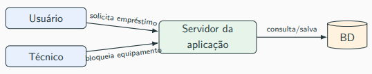
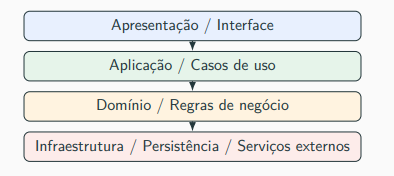
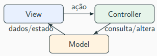

# Aula 10 - Arquitetura em Camadas, Cliente-Sevidor, MVC. monólito e microsserviços

## Conceitos

- **Estilo arquitetural:** organização predominante do sistema; exemplos: cliente-servidor, camadas, monólito e microsserviços.
- **Padrão arquitetural:** solução recorrente para um problema arquitetural; MVC é tratado assim nesta disciplina.
- **Arquitetura concreta:** combinação das decisões adotadas em um sistema real.
- **Trade-off:** benefício obtido em troca de custos ou limitações.
- Os conceitos podem coexistir: uma aplicação pode usar cliente-servidor, camadas, MVC e monólito modular.

## Cliente-servidor

- **Cliente:** solicita recursos ou operações; exemplo: navegador.
- **Servidor:** atende solicitações e concentra dados, regras ou serviços.
- Comunicação comum: requisição–resposta.
- O cliente conhece o contrato da API; não precisa conhecer a implementação interna.
- **Benefícios:** segurança e governança centralizadas, clientes mais leves e simplicidade inicial.
- **Cuidados:** gargalo e indisponibilidade do servidor, latência de rede e compatibilidade entre versões da API.

## Camadas

- Dividem responsabilidades lógicas e controlam dependências.

| Camada | Responsabilidade | Exemplo |
|---|---|---|
| Apresentação | Receber entradas e apresentar respostas. | Tela, controller e endpoint. |
| Aplicação | Coordenar casos de uso. | `EmprestimoService`. |
| Domínio | Representar entidades, regras e invariantes. | Equipamento bloqueado não pode ser emprestado. |
| Infraestrutura | Implementar persistência e integrações. | Acesso ao banco e envio de e-mail. |

- **Invariante:** condição que deve permanecer verdadeira nos estados válidos do sistema.
- A aplicação coordena a operação; o domínio contém as regras centrais.
- O domínio deve ser protegido de detalhes de HTTP, tela, banco e e-mail.
- **Interface interna:** contrato de comunicação entre componentes; pode ser implementado com uma `interface` do Java.
- **Benefícios:** manutenção, testabilidade, responsabilidades delimitadas e substituição de implementações.
- **Riscos:** excesso de indireção, custo adicional de processamento e burocracia.
- **Domínio anêmico:** entidades ficam apenas com dados, enquanto o comportamento é concentrado fora delas.
- Camadas que só repassam chamadas podem acrescentar estrutura sem responsabilidade útil.

## Separação lógica × física

- **Lógica:** pacotes, módulos, responsabilidades e dependências organizados no código.
- **Física:** processos, servidores, bancos ou unidades de implantação separados.
- **Tier:** divisão física de implantação; exemplo: navegador, servidor de aplicação e banco.
- Várias camadas podem executar na mesma aplicação.
- Vários servidores não garantem boa separação de responsabilidades.

## MVC

- Organiza a interação entre interface, ações do usuário e dados/comportamento.

| Elemento | Responsabilidade |
|---|---|
| View | Exibir informações e permitir interação. |
| Controller | Receber a ação, validar a entrada e chamar o caso de uso. |
| Model | Representar dados, estado e comportamento envolvidos. |

- Em uma aplicação em camadas, View e Controller participam da apresentação.
- O controller chama o serviço de aplicação, que utiliza entidades e repositórios.
- **Repository:** organiza operações de consulta e persistência.
- **DTO:** transporta dados entre partes da aplicação, como o resultado de uma operação.
- Validar o formato da entrada difere de decidir se a operação é permitida pelas regras de negócio.
- **Controller gordo:** acumula regras que deveriam estar no domínio ou no caso de uso.
- MVC e camadas têm focos diferentes e podem ser combinados.

## Monólito e monólito modular

- **Monólito:** aplicação implantada como uma única unidade.
- **Deploy:** colocar uma versão da aplicação em execução no ambiente.
- Pode conter várias camadas, usar banco externo e executar em várias instâncias.
- **Monólito modular:** módulos com responsabilidades claras, interfaces internas e dependências controladas.
- **Monólito acidental / big ball of mud:** fronteiras fracas, regras espalhadas e acesso indiscriminado entre partes.
- **Módulos** dividem áreas funcionais; **camadas** dividem responsabilidades. Cada módulo pode ter suas próprias camadas.
- **Benefícios:** operação simples, desenvolvimento inicial rápido, depuração direta e transações locais.
- **Transação local:** agrupa alterações no mesmo banco para confirmar ou desfazer a operação.
- **Limitações:** escala seletiva, deploy independente, coordenação entre equipes grandes e isolamento de falhas.

## Microsserviços

- Serviços com responsabilidades delimitadas e deploys independentes.
- Comunicam-se por rede ou mensagens; cada um pode ter camadas internas.
- Autonomia sobre dados ajuda a preservar a independência; não exige uma máquina física de banco por serviço.
- **API Gateway:** entrada que pode oferecer roteamento, autenticação, autorização, limites de requisições e observabilidade.
- **Benefícios:** deploy independente, escala seletiva, autonomia das equipes e possibilidade de isolamento de falhas.
- **Custos:** comunicação distribuída, coordenação de dados, vários pipelines e maior exigência operacional.

### Mudanças práticas

- Chamadas locais passam a depender da rede: atrasos, falhas e indisponibilidade.
- Transações entre partes podem exigir **consistência eventual**: estados convergem após o processamento das atualizações.
- Investigações exigem **observabilidade distribuída**: relacionar logs, métricas e rastros entre serviços.
- Cada serviço precisa de seu **pipeline** de construção, verificação e implantação.
- Surgem **falhas parciais**: alguns serviços funcionam enquanto outros falham.
- A complexidade passa a envolver comunicação, operação, dados e coordenação.

## Critérios de escolha

| Critério | Favorece monólito modular | Favorece microsserviços |
|---|---|---|
| Equipe | Pequena ou única. | Várias equipes autônomas. |
| Domínio | Fronteiras ainda mudando. | Fronteiras claras. |
| Operação | Pouca maturidade DevOps. | Automação e observabilidade maduras. |
| Dados | Transações locais importantes. | Consistência eventual aceitável onde necessária. |
| Escala | Crescimento moderado. | Necessidades muito diferentes entre partes. |

- Decidir por atributos de qualidade, restrições e custos: confiabilidade, desempenho, manutenção, equipe, prazo e infraestrutura.

## Exemplo: empréstimo de equipamentos

- Fluxo: verificar disponibilidade, registrar empréstimo, definir devolução e enviar confirmação.
- Contexto: equipe pequena, domínio em amadurecimento, entrega rápida e pico de solicitações no início do semestre.
- **Escolha inicial:** cliente-servidor com monólito modular em camadas.
- **Módulos:** empréstimos, equipamentos, usuários e notificações.
- **Dependências proibidas:** domínio depender de controller, tela, implementação do banco ou envio de e-mail.
- **Risco:** perder modularidade ou ter dificuldade para escalar funcionalidades isoladamente.
- **Sinal para evoluir:** notificações ou relatórios precisarem de carga, mudanças ou deploy próprios.

## Sinais de problemas

- Alteração apenas visual afeta regras e banco → separação lógica fraca.
- Toda nova regra vai para o controller → controller gordo.
- Falha na notificação impede registrar empréstimo → **acoplamento temporal**; considerar processamento assíncrono ou tolerância a falhas conforme os requisitos.
- Pequeno ajuste exige deploy conjunto de vários serviços → autonomia insuficiente e coordenação excessiva.

## Perguntas de revisão

- Qual aspecto cada conceito descreve: comunicação, responsabilidades, interface ou implantação?
- Por que camadas não exigem servidores separados?
- Como distinguir coordenação de caso de uso e regra de domínio?
- Quais benefícios justificariam separar um módulo em serviço?
- Por que o monólito modular é adequado ao contexto inicial do exemplo?

---
Fonte: material da Aula 13 — Design de Software.

