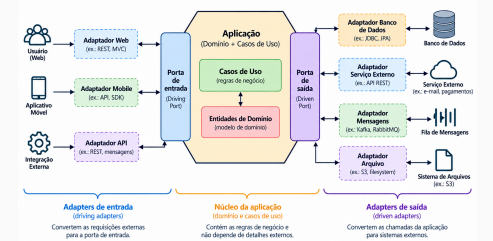
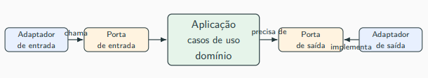
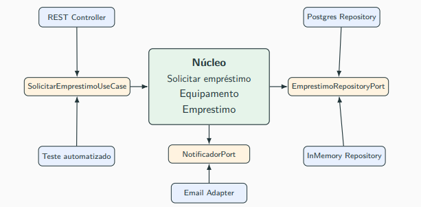
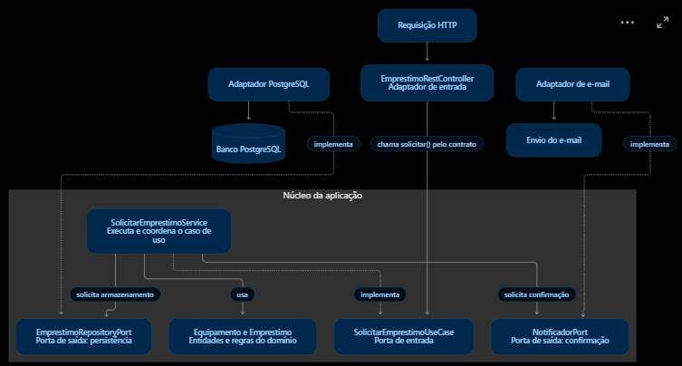

## Aula 11 - Padrões Arquiteturais para controlar dependências: Hexagonal e Clean Architeture

### Objetivo e núcleo

- **Objetivo:** proteger as regras de negócio das tecnologias, facilitando testes e mudanças em banco, interfaces e serviços externos.
- **Domínio:** conceitos e regras centrais, como `Equipamento`, `Emprestimo` e “equipamento indisponível não pode ser emprestado”.
- **Caso de uso:** coordena uma operação usando o domínio; por exemplo, verificar disponibilidade, criar empréstimo, definir devolução, salvar e notificar.
- **Fora do núcleo:** detalhes de HTTP, banco, frameworks e envio de mensagens.

### Arquitetura Hexagonal

- Proposta por **Alistair Cockburn**, também chamada de **Ports and Adapters**.
- Organiza a aplicação em **núcleo, portas e adaptadores**; o desenho não exige seis componentes.
- Pode coexistir com camadas e ser aplicada em monólitos ou microsserviços.

### Portas e adaptadores

| Elemento | Papel | Exemplo |
|---|---|---|
| Porta de entrada | Contrato de uma operação oferecida pelo núcleo | `SolicitarEmprestimoUseCase` |
| Adaptador de entrada | Recebe uma interação externa e chama a operação | `EmprestimoRestController` |
| Porta de saída | Contrato de um recurso necessário ao núcleo | `EmprestimoRepositoryPort`, `NotificadorPort` |
| Adaptador de saída | Implementa o contrato com tecnologia concreta | `PostgresEmprestimoRepository`, `EmailNotificador` |

- **Porta é contrato**, podendo ser representada por uma interface Java; não é endpoint nem porta de rede.
- **Adaptador conecta o exterior ao núcleo:** na entrada, chama uma porta; na saída, implementa uma porta.
- Exemplos de entrada: controller HTTP, CLI, consumidor de fila e resolver GraphQL. Todos podem chamar o mesmo caso de uso.
- Entrada e saída são relativas ao núcleo: consultar o banco é uma interação de saída, mesmo recebendo dados de volta.

### Controller, UseCase e Service

| Componente | Responsabilidade | Localização |
|---|---|---|
| `EmprestimoController` | Recebe HTTP, chama a aplicação e prepara a resposta | Fora do núcleo |
| `SolicitarEmprestimoUseCase` | Declara o contrato de entrada | Núcleo |
| `SolicitarEmprestimoService` | Implementa o contrato e coordena a operação | Núcleo |

- O **controller escolhe qual operação chamar**; a configuração fornece a implementação concreta, manualmente ou por injeção de dependência.
- Ao chamar `solicitar(...)` pela interface, **quem executa é o service**. A interface não é uma etapa intermediária.
- **UseCase não significa obrigatoriamente interface:** neste exemplo é o contrato; em outros projetos, uma classe com esse nome pode conter a implementação.
- O service usa as entidades e solicita persistência e notificação pelas portas de saída; os adaptadores realizam essas tarefas.

### Direção das dependências

- **O núcleo depende de contratos, sem conhecer os adaptadores concretos.**
- Exemplo: o service usa `EmprestimoRepositoryPort`; o adaptador PostgreSQL implementa essa porta.
- **Execução:** o núcleo solicita uma operação que chega ao banco. **Dependência do código:** ele não precisa importar a classe PostgreSQL.
- **Inversão de dependência (SOLID):** orienta quem depende de quem. **Injeção de dependência:** fornece os objetos necessários.

### Clean Architecture e comparação

- **Clean Architecture**, de Robert C. Martin: organiza camadas concêntricas, com dependências apontando para dentro.
- Da mais interna para a mais externa:
  1. **Entidades:** conceitos e regras centrais.
  2. **Casos de uso:** operações da aplicação.
  3. **Adaptadores de interface:** controllers, presenters e adaptadores de repositório; convertem dados entre formatos internos e externos.
  4. **Frameworks e drivers:** web, banco, frameworks e mensageria.
- Camadas internas não devem conhecer código das externas.

| Abordagem | Ênfase |
|---|---|
| Camadas tradicionais | Separar apresentação, negócio e persistência |
| Hexagonal | Conectar o núcleo ao exterior por portas e adaptadores |
| Clean | Organizar camadas com dependências para dentro |
| Onion | Modelo de domínio no centro, cercado por serviços de domínio, aplicação e infraestrutura; afinidade com DDD |

- Clean e Hexagonal são compatíveis; separar pastas, sozinho, não garante independência.
- Organização possível: `domain` para entidades; `application` para casos de uso; `ports/in` e `ports/out` para contratos; `adapters/in` e `adapters/out` para tecnologias.

### Benefícios, custos e quando usar

- **Benefícios:** testar regras sem banco real, oferecer várias entradas e trocar tecnologias com menor impacto.
- **Testes:** usar repositórios em memória e notificadores falsos; testes de integração continuam necessários.
- **Custos:** mais interfaces, classes, indireção, configuração e conversões de dados/DTOs.
- **Riscos:** abstrações artificiais e estrutura excessiva para problemas simples (*overengineering*).
- **ASRs:** requisitos arquiteturalmente significativos. Testabilidade, modificabilidade e isolamento do domínio podem justificar essas arquiteturas.
- **Trade-off:** ganha-se independência e facilidade de evolução, pagando com maior estrutura e esforço inicial.

### Perguntas para revisar

- Qual a diferença entre domínio, caso de uso, porta e adaptador?
- Quem executa a operação chamada pelo controller através da interface?
- Como o núcleo acessa o banco sem depender da implementação concreta?
- Quando os benefícios compensam a estrutura adicional?
