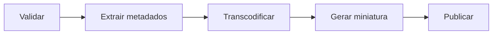
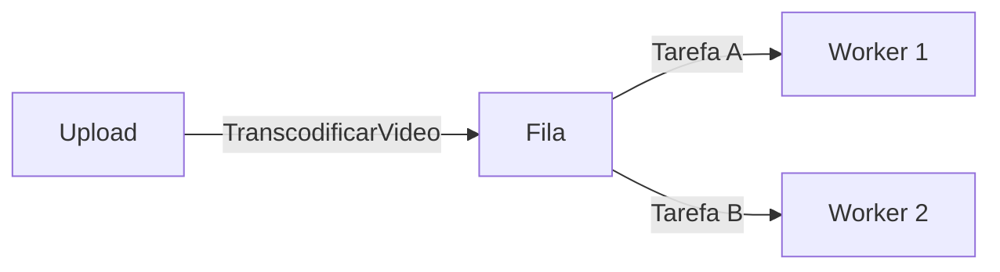
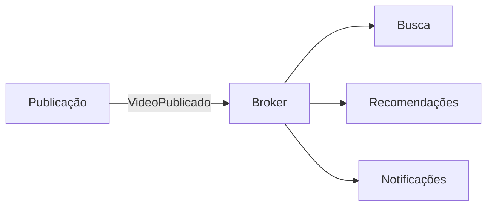

## Aula 12- Pipes and Filters, Mensagens, Brokens, filas, Pub/Sub, consistência eventual e idempotência

### Comunicação síncrona e assíncrona

- **Síncrona:** o emissor espera a resposta para continuar o fluxo.
- Indicada quando o resultado imediato é necessário.
- **Acoplamento temporal:** a indisponibilidade do serviço chamado afeta quem espera.
- **Assíncrona:** o emissor encaminha o trabalho sem esperar sua conclusão.
- Indicada para tarefas demoradas, picos de carga e reações independentes.
- A comunicação afeta desempenho, disponibilidade, consistência e testabilidade.

**Exemplo da aula — upload de vídeo:**

- **Antes de responder “recebido”:** receber arquivo, validar tipo/tamanho, registrar metadados e colocar o trabalho na fila.
- **Depois:** transcodificar, gerar miniatura, atualizar busca, recomendações e analytics.
- **Caminho crítico:** atividades necessárias antes da resposta ao usuário.

### Pipes and Filters

- Divide o processamento em uma sequência de etapas.
- **Filter:** transforma ou analisa os dados.
- **Pipe:** transporta a saída de uma etapa para a próxima.
- Usado em ETL, compiladores e processamento de logs, áudio, imagens e vídeos.

- **Validar:** conferir formato e integridade do arquivo.
- **Extrair metadados:** obter duração, resolução e codec.
- **Transcodificar:** converter para diferentes formatos e resoluções.
- **Gerar miniatura:** extrair uma imagem para exibição.
- **Publicar:** disponibilizar o vídeo processado.
- **Vantagens:** responsabilidades separadas, filtros reutilizáveis e etapas substituíveis; permite paralelismo em alguns casos.
- **Custos:** latência acumulada, conversões entre formatos e tratamento de falhas.
- A ordem das etapas e o estado compartilhado podem dificultar o pipeline.

### Arquitetura orientada a mensagens

- Componentes trocam mensagens, normalmente por um broker ou fila.
- **Produtor:** envia a mensagem.
- **Consumidor:** recebe e processa a mensagem.
- **Broker:** intermedeia a comunicação; recebe, armazena e encaminha mensagens.
- Pode apoiar entrega e novas tentativas de processamento.

**Mensagem pode representar comando ou evento:**

| Comando: solicita uma ação | Evento: informa um fato ocorrido |
|---|---|
| `TranscodificarVideo` | `VideoTranscodificado` |
| `GerarThumbnail` | `ThumbnailGerada` |
| `PublicarVideo` | `VideoPublicado` |
| `IndexarVideo` | `VideoIndexado` |
| `EnviarNotificacao` | `NotificacaoEnviada` |
| `RemoverVideo` | `VideoRemovido` |

- Comandos normalmente têm um responsável pelo processamento.
- Eventos podem interessar a vários consumidores independentes.

### Fila / Point-to-Point

- Distribui trabalho entre consumidores equivalentes, chamados **workers**.
- Cada tarefa deve ser processada por um consumidor do grupo.
- Absorve picos e permite aumentar a capacidade adicionando workers.
- **Exemplo:** mil vídeos aguardam transcodificação; workers retiram tarefas conforme ficam livres.

### Arquitetura orientada a eventos e Pub/Sub

- **Event-Driven Architecture:** organiza o sistema pela produção e reação a eventos.
- O produtor comunica um acontecimento sem conhecer todos os interessados.
- **Publish/Subscribe:** distribui uma publicação a vários assinantes.
- **Tópico:** canal de publicações ao qual os interessados se inscrevem.

- Busca atualiza o índice; Recomendações atualiza seus dados; Notificações avisa seguidores.
- Analytics também pode consumir o evento para registrar métricas.
- **Fila divide trabalho; Pub/Sub distribui acontecimentos.**
- Eventos precisam de dados suficientes, contrato e versionamento.
- Exemplo de campos: `eventId`, `type`, `videoId`, `canalId` e `publicadoEm`.

**Combinando os padrões na plataforma:**

- O pipeline prepara e publica o vídeo.
- A publicação gera `VideoPublicado`.
- O broker distribui o evento aos serviços interessados.
- No exemplo mais completo, o API Gateway encaminha requisições HTTP aos serviços.
- Upload inicia o fluxo; Processamento prepara o vídeo; Catálogo gerencia metadados e visibilidade.
- Usuários e Comentários também publicam eventos, como `UsuarioRegistrado` e `ComentarioCriado`.
- A arquitetura combina requisições síncronas e processamento por eventos.

### Consistência eventual

- Componentes podem apresentar estados temporariamente diferentes.
- Posteriormente, convergem com o processamento das atualizações.
- **Exemplo:** o vídeo já está disponível, mas busca e recomendações atualizam segundos depois.
- **Ganho:** desacoplamento e resiliência.
- **Custo:** inconsistência temporária.

| Geralmente aceitável | Exige cuidado |
|---|---|
| Busca e recomendações | Cobrança e quotas de upload |
| Analytics e dashboards | Autorização de acesso |
| Notificações | Exclusão por violação e moderação crítica |

### Duplicação, idempotência e garantias de entrega

- Um consumidor pode processar uma mensagem e falhar antes de confirmar.
- A mensagem pode ser entregue novamente.
- **Idempotência:** repetir a operação mantém o resultado final da primeira execução.
- **Exemplo:** receber `VideoPublicado` duas vezes não deve criar duas entradas na busca.

| Risco | Estratégia |
|---|---|
| Criar cópias no índice | Atualizar pelo `videoId` ou usar upsert |
| Processar o mesmo evento novamente | Registrar o `eventId` processado |
| Incrementar contadores ou enviar avisos duplicados | Controlar repetição dos efeitos |

- **Upsert:** inserir se não existir; atualizar se já existir.

| Garantia | Significado | Risco ou limitação |
|---|---|---|
| At-most-once | Zero ou uma vez | Perda de mensagem |
| At-least-once | Uma ou mais vezes | Duplicação |
| Exactly-once | Efeito único no escopo garantido | Difícil e limitado na prática |

- Combinação frequente: **at-least-once + consumidor idempotente**.

### Ordenação, retry e Dead Letter Queue

- Eventos podem chegar fora de ordem.
- **Exemplo:** `VideoRemovido` chega antes de um `VideoPublicado` atrasado.
- Risco: o consumidor restaura um estado que deveria continuar removido.
- Estratégias: versão, timestamp, partição por chave e validação de estado.
- **Retry:** tentar processar novamente após uma falha.
- **DLQ:** separar mensagens com falhas repetidas para análise e correção posterior.

### Requisitos e trade-offs arquiteturais

- **ASRs:** requisitos arquiteturalmente significativos.
- Podem justificar o uso de comunicação assíncrona:
  - Absorver picos de uploads.
  - Responder rapidamente ao usuário.
  - Executar tarefas demoradas em segundo plano.
  - Publicar vídeos mesmo com Recomendações indisponível.
  - Adicionar consumidores sem alterar o produtor.

| Ganho | Custo |
|---|---|
| Desacoplamento temporal | Complexidade operacional |
| Absorção de picos | Filas, broker e monitoramento |
| Consumidores independentes | Evolução dos contratos |
| Resiliência a falhas temporárias | Consistência eventual |
| Processamento paralelo | Controle da ordenação |
| Reentrega de mensagens | Consumidores idempotentes |

- A arquitetura precisa tratar contratos, falhas, duplicação, ordem e consistência.
- **Observabilidade:** acompanhar o processamento e identificar atrasos e erros.

Fonte: slides da aula 18 — “Arquiteturas de comunicação assíncrona”, Prof. Simone Dominico.

### O que guardar

| Conceito | Pergunta-chave |
|---|---|
| Síncrono | Preciso do resultado agora? |
| Pipes and Filters | Quais etapas transformam o vídeo? |
| Broker | Quem distribui as mensagens? |
| Orquestrador | Quem decide o próximo passo? |
| Fila | Como dividir tarefas? |
| Pub/Sub | Quem reage ao mesmo fato? |
| Consistência eventual | Quanto atraso é aceitável? |
| Idempotência | Repetir mantém o resultado correto? |

### Perguntas para revisar

1. Por que “upload recebido” não significa “vídeo publicado”?
2. Por que Usuários e Comentários usam o mesmo broker?
3. O que muda entre `PublicarVideo` e `VideoPublicado`?
4. Como uma falha pode causar uma notificação duplicada?
5. Quem decide publicar após o processamento: broker ou orquestrador?

