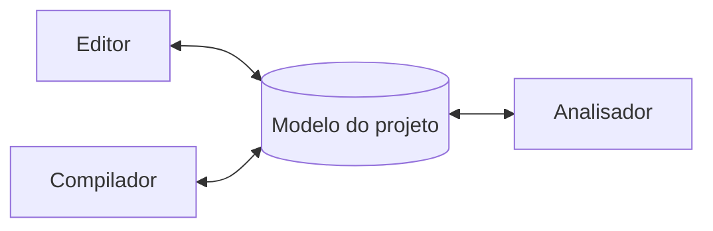
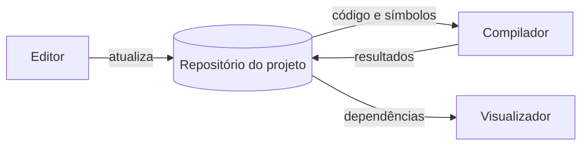
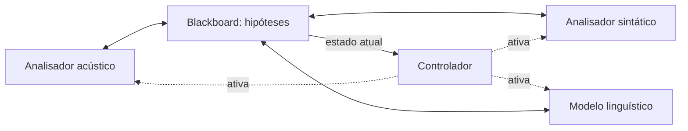
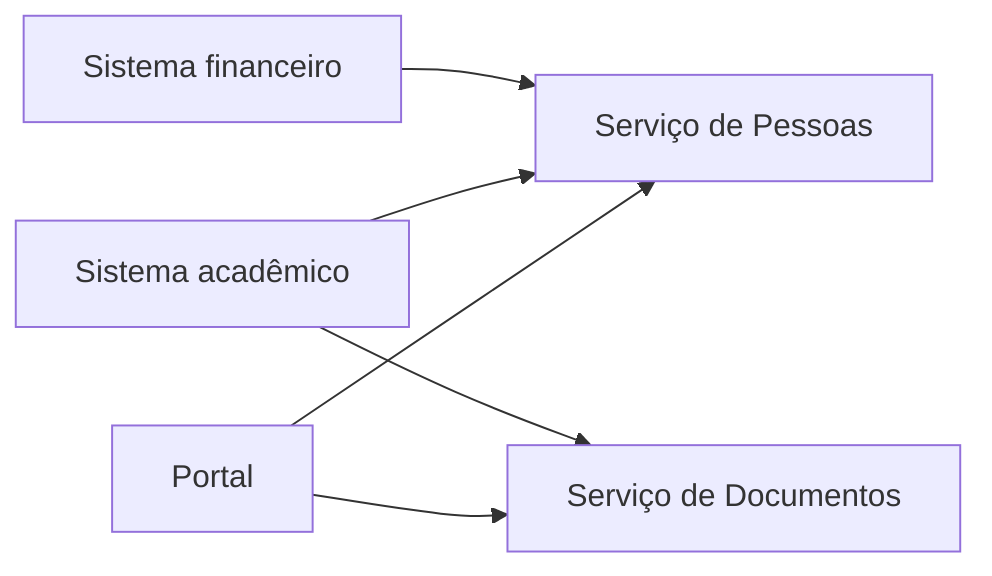
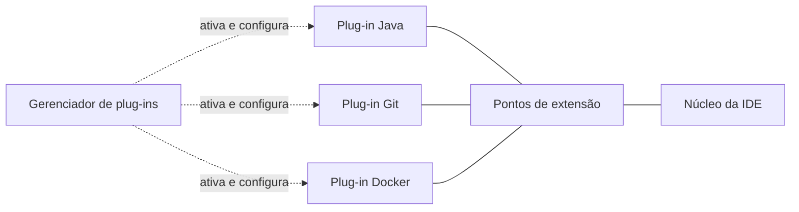

## Aulas 13 - Data-Centered Architecture, Repository, Blackboard, SOA e Microkernel

<!-- **Data-Centered** é um estilo arquitetural em que os componentes se integram principalmente por meio de dados compartilhados em um armazenamento central, que pode ser fisicamente distribuído. Suas duas variantes clássicas são **Repository**, em que componentes consultam e atualizam informações comuns para realizar suas tarefas, e **Blackboard**, em que especialistas compartilham hipóteses e resultados parciais para construir uma solução em conjunto. Outras variantes podem aparecer conforme a classificação adotada, mas ter um banco de dados, por si só, não caracteriza Data-Centered: os dados compartilhados precisam ser o principal meio de integração do sistema. -->

### 1. Data-Centered Architecture

- Componentes se integram por **dados compartilhados em um repositório central**.
- Exemplo: editor, compilador e analisador usam um modelo comum do projeto.
- **Indicado para:** fonte única de verdade, consistência e governança centralizadas.
- **Vantagens:** menor duplicação e visão comum dos dados; facilita auditoria e backup.
- **Custos:** gargalo, possível ponto único de falha e dependência do esquema de dados.
- Alterações no esquema podem afetar vários componentes e reduzir sua autonomia.

**Exemplo — dados compartilhados:**

### 2. Repository Architecture

- Variante de Data-Centered: o **repositório é o principal meio de integração**.
- Várias ferramentas consultam e atualizam o mesmo conjunto de dados.
- **Repository Architecture:** organiza a integração do sistema em torno do repositório.
- **Repository Pattern:** encapsula o acesso à persistência dentro da aplicação.
- São decisões de níveis diferentes: arquitetura do sistema × organização do código.

**Exemplo — integração pelo repositório:**

### 3. Blackboard Architecture

- Variante de Data-Centered voltada à **colaboração entre especialistas**.
- O blackboard guarda hipóteses, evidências e soluções parciais.
- Especialistas leem esse estado e acrescentam contribuições para refiná-lo.
- Um mecanismo de controle coordena quais especialistas atuam.
- **Exemplo:** interpretação de áudio com análises acústica, linguística e sintática.
- **Vantagens:** solução incremental, integração de especialistas e ordem flexível.
- **Custos:** controle complexo, manutenção do estado, depuração difícil e gargalos.

**Diferença para Pipes and Filters:**

- **Pipes and Filters:** a saída de uma etapa alimenta a próxima; foco em transformação.
- **Blackboard:** especialistas colaboram sobre o estado; a ordem pode ser dinâmica.

**Exemplo — interpretação de áudio:**

### 4. SOA — Service-Oriented Architecture

- Expõe **capacidades de negócio como serviços com contratos explícitos**.
- Diferentes sistemas podem reutilizar e combinar essas capacidades.
- **Exemplo:** sistemas financeiro, acadêmico e portal usam serviços institucionais.
- **Contrato:** define operações, entradas, respostas e erros possíveis.
- **Interoperabilidade:** permite integração entre linguagens e plataformas diferentes.
- Busca baixo acoplamento entre consumidores e provedores.

**ESB — Enterprise Service Bus:**

- Barramento que pode mediar a integração entre sistemas e serviços.
- Faz roteamento, transformação de formatos e adaptação da comunicação.
- É comum em SOA tradicional, mas **não é obrigatório**.

**Quando usar e custos:**

- **Indicado para:** sistemas heterogêneos, integração de legados e reutilização.
- **Custos:** governança, versionamento, latência e monitoramento distribuído.
- Serviços compartilhados criam dependências entre vários consumidores.
- Mudanças nos contratos exigem cuidado com compatibilidade.

**SOA × microsserviços:**

- **SOA:** enfatiza integração empresarial e reutilização entre sistemas.
- **Microsserviços:** enfatizam autonomia, deploys e evolução independente.
- Governança centralizada e ESB são comuns em SOA tradicional.
- Microsserviços costumam preferir comunicação leve e equipes autônomas.
- A divisão não é rígida: microsserviços herdaram ideias de SOA.

**Exemplo — serviços institucionais compartilhados:**

### 5. Microkernel / Plug-in Architecture

- Mantém um **núcleo mínimo e estável**, ampliado por plug-ins.
- **Exemplo:** IDE com extensões para Java, Git, Docker e testes.

**Elementos:**

- **Núcleo:** funcionalidades essenciais, estáveis e comuns.
- **Pontos de extensão:** locais e mecanismos de conexão dos plug-ins.
- **Plug-ins:** funcionalidades opcionais, específicas ou variáveis.
- **Gerenciador:** carrega, configura, ativa, desativa e gerencia versões.
- **Contrato de extensão:** define o que cada plug-in deve oferecer.

**Quando usar e custos:**

- **Indicado para:** customização e novas funções sem modificar o núcleo.
- **Vantagens:** extensibilidade, funções opcionais e evolução dos plug-ins.
- **Custos:** APIs de extensão complexas, compatibilidade e depuração.
- Exige gestão do ciclo de vida e cuidado com plug-ins problemáticos.
- Decisão central: **o que pertence ao núcleo e o que deve ser extensão?**

**Exemplo — IDE com extensões:**

### 6. Escolha orientada por ASRs

- **ASRs:** requisitos arquiteturalmente significativos; orientam a escolha do estilo.
- Toda escolha envolve benefícios e custos (*trade-offs*).

| Necessidade dominante | Estilo candidato |
|---|---|
| Fonte única de verdade e dados comuns | Data-Centered / Repository |
| Especialistas refinando hipóteses | Blackboard |
| Interoperabilidade e capacidades reutilizáveis | SOA |
| Núcleo estável e extensões opcionais | Microkernel |

### 7. Aplicação: cadastro compartilhado

- **Cenário:** cinco sistemas mantêm cópias parciais dos dados de pessoas.
- **Data-Centered:** compartilha um repositório; exige aceitar dependência do esquema.
- **SOA:** oferece consulta e atualização por serviços; exige contratos e disponibilidade.
- Mais de uma solução pode ser defensável, conforme os ASRs.
- **Justificativa:** qual necessidade a escolha atende e qual custo introduz?
