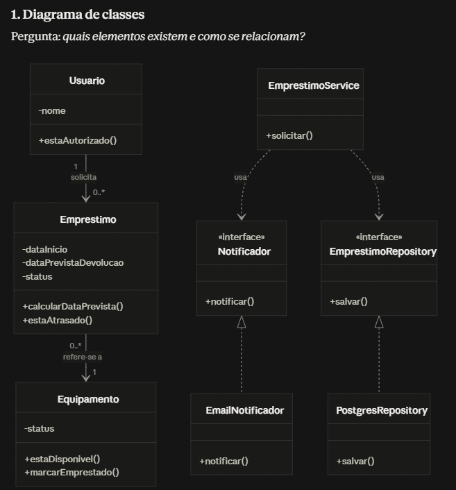
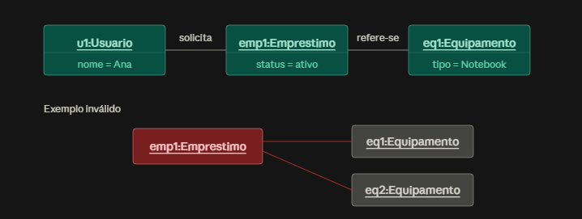
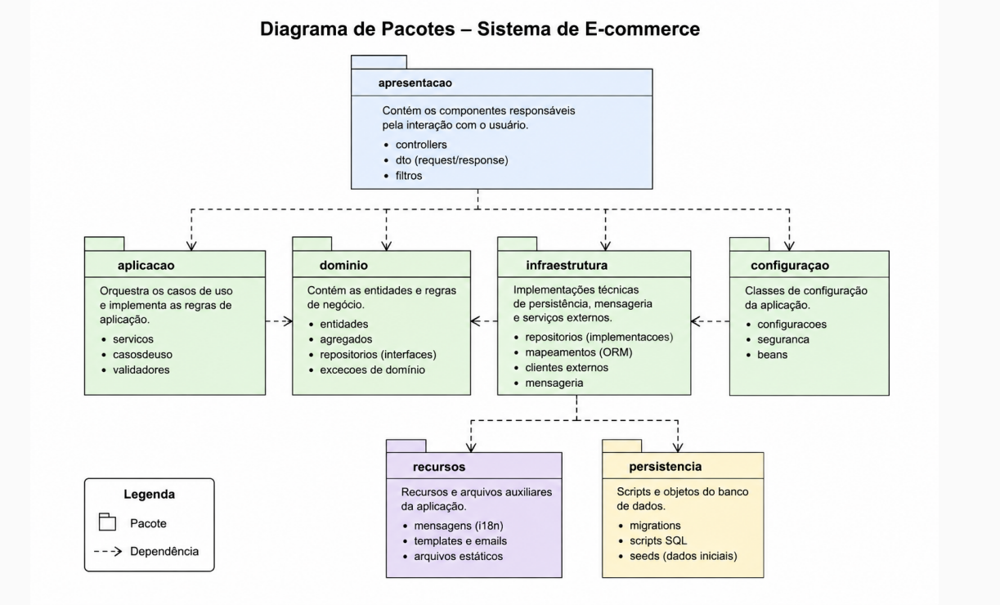
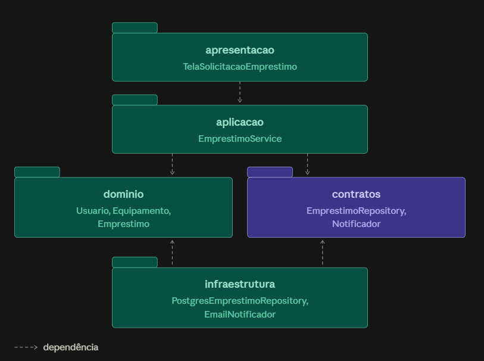
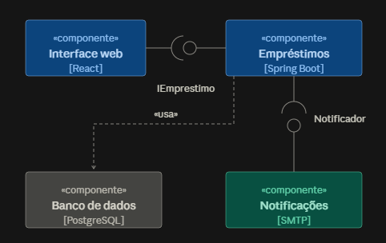

# Parte 1 — Diagramas Estruturais

## 1. Diagrama de classes

Responde à pergunta: **quais elementos existem e como eles se relacionam?**

- Uma classe só entra no design se tiver **papel**, **responsabilidade** e **colaboração** com outros elementos.
- Um substantivo do domínio, sozinho, não justifica a criação de uma classe.

### Principais relações

| Relação | Descrição | Exemplo |
|---|---|---|
| Associação | Relação estrutural duradoura; vira atributo ou referência | — |
| Composição | A parte não faz sentido fora do todo e deixa de existir com ele | Válido: `Pedido–ItemPedido` / Inválido: `Consulta–Paciente` |
| Dependência | Uso pontual, sem posse | `EmprestimoService` usa `Notificador` |
| Interface e realização | A interface define um contrato estável; várias classes o implementam | `EmailNotificador`, `SmsNotificador` |



### Símbolos utilizados

| Símbolo | Significado |
|---|---|
| Caixa dividida em três faixas | Nome, atributos e operações da classe |
| `-` e `+` | Membro privado e membro público |
| Linha cheia com `1` e `0..*` | Associação com multiplicidade |
| Linha tracejada com seta aberta | Dependência: usa, mas não armazena |
| Linha tracejada com triângulo vazado | Realização: implementa uma interface |
| `«interface»` | Contrato sem implementação concreta |
| Losango cheio | Composição |

### Como interpretar a multiplicidade

- Lê-se sempre **do lado oposto** da relação.
- Um `Usuario` solicita de zero a muitos empréstimos (`0..*`).
- Cada `Emprestimo` refere-se a exatamente um equipamento (`1`).
- `EmprestimoService` tem apenas setas tracejadas saindo, todas para interfaces → design com **inversão de dependências**.


## 2. Diagrama de objetos

- É uma **fotografia das instâncias reais** existentes em determinado instante.
- Serve principalmente para **validar** o modelo, não apenas documentá-lo.
- Exemplo: se o diagrama de classes define `1` equipamento por empréstimo e o diagrama de objetos mostra `emp1` ligado a `eq1` e `eq2`, a multiplicidade foi violada.
- Se não for possível montar um exemplo concreto e coerente, o diagrama de classes provavelmente está confuso ou errado.



---

## 3. Diagrama de pacotes

Representa a **organização modular** do sistema. Pacotes do exemplo:

- **apresentacao** — componentes de interação com o usuário.
- **aplicacao** — orquestra os casos de uso e coordena as operações necessárias.
- **infraestrutura** — detalhes técnicos: bancos de dados, serviços externos e outras tecnologias.
- **configuracao** — classes responsáveis pela configuração da aplicação.
- **dominio** — entidades e regras centrais. Todas as setas chegam nele; nenhuma sai.
- **contratos** — interfaces que definem os contratos entre as partes do sistema.


### Direção das dependências

O tema central do diagrama. Ciclos devem ser evitados:

```
emprestimos → notificacoes → persistencia → emprestimos
```

Ciclos causam:

- propagação de mudanças pelo sistema;
- aumento do acoplamento;
- dificuldade nos testes;
- manutenção mais complexa.

**Solução:** inverter a dependência para um pacote de `contratos` — representação gráfica do **Princípio da Inversão de Dependência (SOLID)**.




## 4. Diagramas de componentes

**Pergunta que responde:** quais partes do sistema colaboram por interfaces?

**O que é um componente**
- Unidade modular que encapsula uma implementação e expõe ou requer interfaces.
- Pode ser: módulo, biblioteca, serviço, adapter de infraestrutura ou sistema externo.
- Teste: dá para trocar a peça inteira por outra que respeite o mesmo contrato?



**Notação**
- Caixa com `«componente»` e, opcionalmente, a tecnologia entre colchetes.
- Ícone de componente no canto (retângulo com duas abinhas).
- Porta: quadradinho na borda, o ponto de comunicação.
- **Bolinha (pirulito)** = interface **fornecida**: "eu ofereço".
- **Meia-lua (soquete)** = interface **requerida**: "eu preciso".
- Bolinha encaixada no soquete = conector de montagem.
- Seta tracejada = dependência simples, sem contrato nomeado.

**Como ler**
- Quem tem o soquete depende; quem tem o pirulito atende.
- Quem requer não sabe quem vai atender, só conhece o nome do contrato.

**O que revela (e a classe não mostra)**
- fronteiras maiores do sistema;
- partes substituíveis ou evoluíveis separadamente;
- interfaces entre módulos;
- dependências externas;
- comunicação entre subsistemas.

**Como montar**
1. Agrupe pacotes que mudam juntos.
2. Nomeie pela responsabilidade, não pela tecnologia.
3. Tudo que atravessa a fronteira vira interface.
4. Nomeie a interface pela necessidade de quem chama (`Notificador`, não `EnviadorSmtp`).
5. Marque as dependências externas (banco, gateways, terceiros).

**Erros comuns**
- Usar componente como sinônimo de classe.
- Ligar caixas com linha sem dizer o contrato.
- Nomear a interface pela implementação.
- Inverter pirulito e soquete.

**Pergunta clássica de prova**
- "Qual componente pode ser substituído com menor impacto?" Resposta: aquele cuja única coisa que atravessa a fronteira é um contrato.

## Atividades

### Atividade 2 — Criação de três visões estruturais

Escolher um dos casos:

1. **Fechar pedido** — calcular total, aplicar desconto, cobrar pagamento, registrar pedido e notificar o cliente.
2. **Reservar sala** — verificar disponibilidade, registrar reserva, aplicar regra de prioridade e enviar confirmação.
3. **Solicitar manutenção** — registrar problema, classificar prioridade, atribuir técnico e notificar o solicitante.

**Entrega:** diagrama de classes, diagrama de pacotes e diagrama de componentes. Se houver tempo, incluir também um diagrama de objetos.

### Atividade 3 — Validação por meio do diagrama de objetos

Com base no diagrama de classes do sistema de empréstimos:

- criar dois usuários;
- criar três equipamentos;
- representar dois empréstimos ativos;
- incluir propositalmente um caso inválido;
- explicar qual regra do diagrama de classes foi violada.

**Objetivo:** usar o diagrama de objetos como ferramenta de validação, não apenas como desenho ilustrativo.

### Atividade 4 — Organização em pacotes

Agrupar em pacotes e desenhar as dependências entre eles:

- `Usuario`
- `Equipamento`
- `Emprestimo`
- `EmprestimoService`
- `EmprestimoRepository`
- `PostgresEmprestimoRepository`
- `Notificador`
- `EmailNotificador`
- `TelaSolicitacaoEmprestimo`

Depois responder:

- Há algum ciclo entre os pacotes?
- Há algum pacote com responsabilidades demais?

