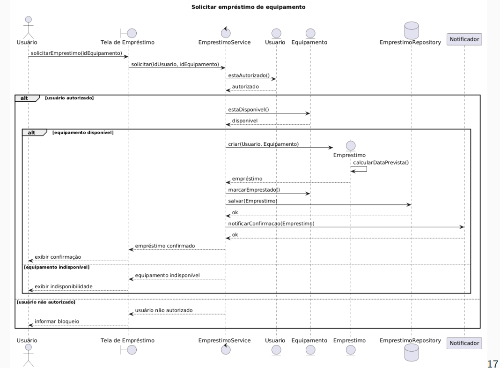
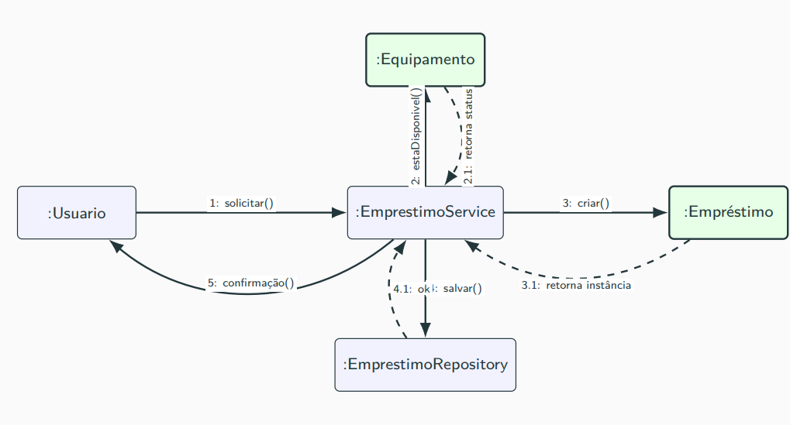
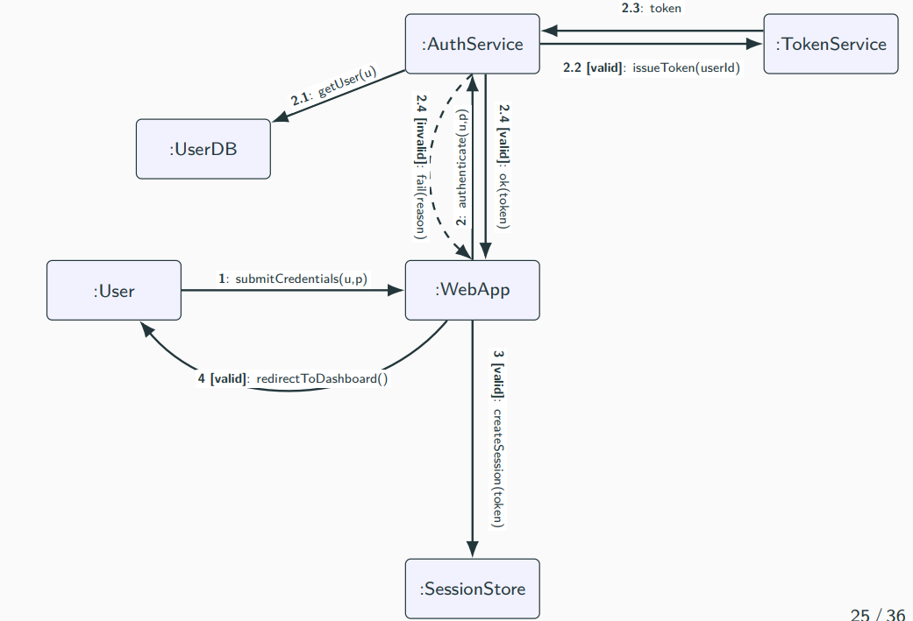
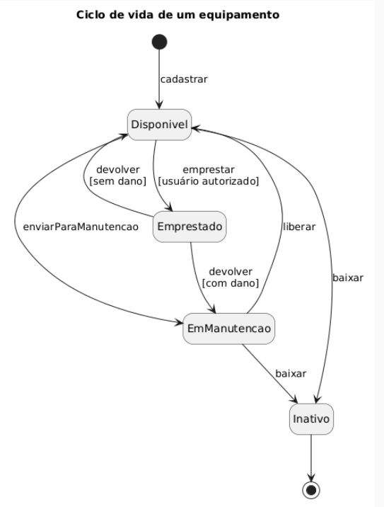

# Diagramas comportamentais

## A estrutura é suficiente?

Não. A estrutura mostra **quais elementos existem e como se relacionam**, mas não explica completamente como um caso de uso é executado.

## Caso-base: empréstimo de equipamento

Um usuário solicita um equipamento. O sistema:

1. verifica se o usuário está autorizado;
2. verifica a disponibilidade do equipamento;
3. cria e registra o empréstimo;
4. atualiza o estado do equipamento;
5. envia uma confirmação.

### Participantes

- `Usuario`, `Equipamento` e `Emprestimo`: objetos do domínio.
- `EmprestimoService`: coordena o caso de uso.
- `EmprestimoRepository`: abstrai a persistência.
- `Notificador`: abstrai o envio da confirmação.

## Visão geral

| Diagrama | Pergunta principal | Ajuda a analisar |
|---|---|---|
| Sequência | Em que ordem as mensagens acontecem? | Responsabilidades e fluxos alternativos |
| Comunicação | Quem conversa com quem? | Acoplamento e distribuição da colaboração |
| Estados | Como a entidade muda ao longo do tempo? | Eventos válidos e transições proibidas |

## 1. Diagrama de sequência

Mostra as mensagens trocadas entre os participantes em ordem temporal.

### Elementos principais
- **Linhas de vida:** participantes da interação.
- **Barras de ativação:** período de execução de uma operação.
- **Mensagem síncrona:** o emissor aguarda a conclusão.
- **Mensagem assíncrona:** o emissor pode continuar a execução.
- **Retorno:** geralmente representado por uma linha tracejada.
- **Fragmentos `alt`, `opt` e `loop`:** representam variações do fluxo.

### Responsabilidades 
- `EmprestimoService` coordena o processo.
- `Usuario` conhece sua autorização.
- `Equipamento` controla sua disponibilidade e seu estado.
- `Emprestimo` aplica suas regras e calcula a data prevista.
- `EmprestimoRepository` e `Notificador` isolam persistência e notificação.

### Fluxos 

- **Principal:** usuário autorizado e equipamento disponível.
- **Alternativos:** usuário não autorizado, equipamento indisponível, falha no registro ou falha na notificação.
- Fragmentos `alt` aninhados permitem representar vários cenários no mesmo diagrama.

## 2. Diagrama de comunicação

Mostra os objetos, suas ligações e as mensagens numeradas. Seu foco está na estrutura da interação.

Ajuda a identificar:
- objetos centralizadores;
- excesso de dependências;
- ausência de objetos especialistas.

## 3. Diagrama de estados — slides 26 a 28

Mostra os estados que uma entidade pode assumir e os eventos que provocam suas transições.

É útil quando o comportamento depende do estado atual, pois evidencia que:

- nem toda ação é válida em qualquer momento;
- o estado atual limita as próximas ações;
- algumas transições dependem de regras de negócio;
- estados mal definidos geram condicionais espalhadas pelo código.

## Conclusão

A estrutura identifica os participantes e suas relações. Os diagramas comportamentais explicam **como eles colaboram durante a execução do caso de uso**.