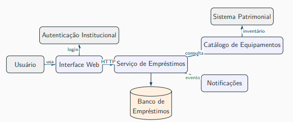

# Aula 9 — Fundamentos de arquitetura de software

## 1. Arquitetura e design detalhado

- **Arquitetura:** estruturas e decisões relevantes para construir, avaliar e evoluir o sistema; envolve componentes, comunicação, dados, integrações e implantação.
- **Design detalhado:** classes, métodos, responsabilidades e colaboração entre objetos.
- A arquitetura orienta e restringe o design; seu valor inclui explicar os motivos e as consequências das escolhas.

## 2. Componentes, conectores e interfaces

- **Componente — quem faz:** parte com responsabilidade e fronteira reconhecíveis. Ex.: Serviço de Empréstimos, Catálogo, Notificações e Banco de Empréstimos.
- **Conector — como interage:** mecanismo de comunicação ou coordenação. Ex.: HTTP, fila, evento, acesso ao banco, arquivo compartilhado e RPC/gRPC.
- **Interface — qual é o contrato:** operações, entradas, saídas, erros, autorização, garantias e compatibilidade.
- **Fornecida:** funcionalidade que um componente oferece. 
- **Requerida:** funcionalidade de que ele depende.
- Nomear componentes pela responsabilidade, não apenas pela tecnologia; dizer apenas “API” não esclarece o contrato.
- Separar componentes não exige executá-los como microsserviços.

## 3. Comunicação e consequências

- **Síncrona:** solicitante espera a resposta; adequada a consultas imediatas. Cria dependência temporal e pode propagar falhas.
- **Fila assíncrona:** permite processar depois e absorver picos; exige monitoramento, retentativas e tratamento de duplicidade.
- **Evento publicado:** comunica um acontecimento a interessados; pode dificultar rastreamento e ordenação.
- **Banco compartilhado:** facilita integração inicial, mas aumenta o acoplamento entre componentes.
- **Arquivo compartilhado:** útil em integrações legadas ou em lote; pode gerar atrasos e erros difíceis de rastrear.
- **Consistência eventual:** atualizações podem levar tempo para aparecer em todas as partes.
- **Idempotência:** repetir uma operação não deve produzir efeitos adicionais indevidos.

## 4. Stakeholders e preocupações

- **Stakeholders:** pessoas, grupos ou organizações que influenciam o sistema ou são afetados por ele.
- Usuário: facilidade de uso, resposta rápida e clareza.
- Equipe de empréstimos: regras, histórico, bloqueios e exceções.
- TI: integração, disponibilidade, monitoramento, implantação e suporte.
- Patrimônio e auditoria: inventário, responsabilidade e rastreabilidade.
- Segurança: autenticação, autorização e proteção de dados.
- Administração: indicadores, custos e redução de retrabalho.

## 5. Visões arquiteturais

- **Contexto:** usuários e sistemas externos.
- **Componentes:** partes internas e responsabilidades.
- **Dados:** armazenamento, compartilhamento e sincronização.
- **Implantação:** onde cada parte executa e como é operada.
- **Decisões:** alternativas escolhidas, justificativas e consequências.

## 6. Decisões arquiteturais e ADR

- Uma decisão tende a ser arquitetural quando afeta vários componentes, qualidades importantes, custos de mudança ou escolhas futuras.
- Exemplos: autenticação institucional obrigatória, notificações assíncronas e separação entre Catálogo e Empréstimos.
- Escolher o nome de um método costuma ser uma decisão local.
- Justificar escolhas pelo contexto e pelas necessidades; “é mais moderno” não explica sua adequação.
- **ADR — Architectural Decision Record:** registra contexto, alternativas, decisão e consequências.

## 7. Atributos de qualidade e trade-offs

- **Trade-off:** benefício acompanhado de custo, risco ou limitação.
- **Desempenho:** cache acelera consultas, mas pode retornar dados desatualizados.
- **Disponibilidade:** redundância reduz impacto de falhas, mas aumenta custo operacional.
- **Segurança:** autorização e auditoria protegem operações, mas acrescentam complexidade.
- **Rastreabilidade:** logs permitem reconstruir ações, mas exigem armazenamento e gestão.
- **Modificabilidade:** separar responsabilidades facilita evolução, mas exige contratos entre componentes.

## 8. Caso da aula: empréstimo de equipamentos

- Interface Web acessa Empréstimos; Empréstimos consulta Catálogo, persiste registros e publica eventos para Notificações.
- Autenticação Institucional e Sistema Patrimonial são integrações externas.
- Enviar notificações de forma assíncrona evita que uma falha de envio bloqueie a aprovação; exige retentativas e controle de duplicidade.
- **Risco de concorrência:** duas solicitações podem consultar disponibilidade antes de qualquer reserva ser concluída.
- Uma fila absorve picos, mas não garante sozinha a ausência de reservas duplicadas.
- Controle transacional adequado de concorrência protege a confirmação da reserva, podendo gerar espera.

## 9. Impacto no design e análise

- Notificações assíncronas exigem contrato de evento, handler, estado de envio e idempotência.
- Catálogo separado exige contrato de consulta, DTOs, compatibilidade e tratamento de indisponibilidade.
- Roteiro de análise: stakeholders → preocupações → componentes → conectores → interfaces → decisões e qualidades → riscos e trade-offs → registro.

## 10. Arquitetura, estilo e padrão

- **Arquitetura concreta:** organização e decisões do sistema específico.
- **Estilo arquitetural:** princípios e restrições gerais de organização.
- **Padrão arquitetural:** solução estrutural recorrente para um problema em determinado contexto.

Fonte: slides da aula de 29/09/2026, Prof.ª Simone Dominico, “Design de Software, Arquitetura e Projeto de Sistemas”.

